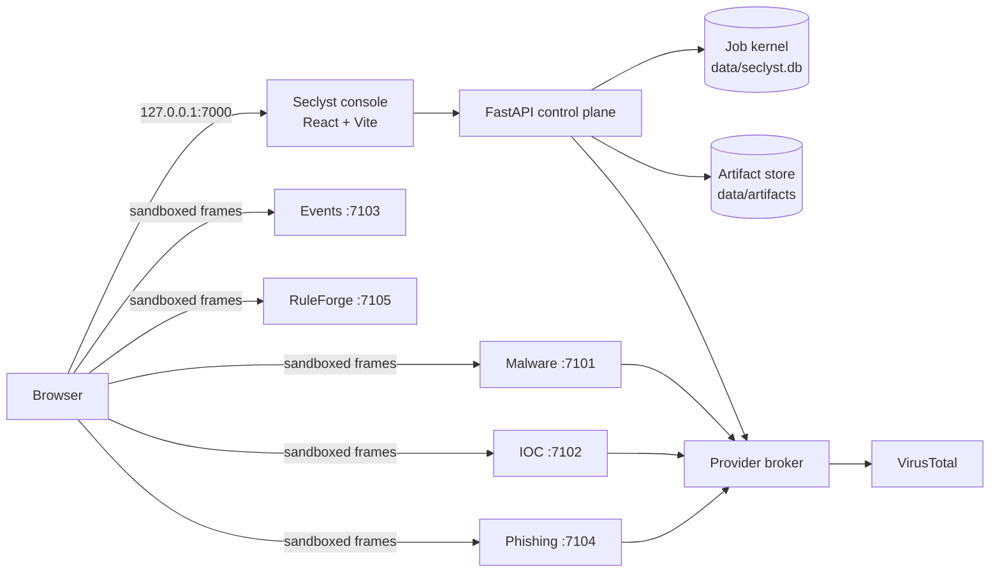

# Seclyst — Detailed Documentation

This is the deep-dive reference for the whole project. It is written in plain
language: what each of the five tools does, how the platform that hosts them
works, how to configure and run it, how the pieces store data, and how to extend
it safely.

If you only want to run it, the [README](README.md) is enough. Come here when you
want to understand it or change it.

**Contents**

1. [The five tools in depth](#the-five-tools-in-depth)
2. [What the platform does, and why](#what-the-platform-does-and-why)
3. [How the pieces fit together](#how-the-pieces-fit-together)
4. [Where the code lives](#where-the-code-lives)
5. [Data and storage](#data-and-storage)
6. [Configuration and credentials](#configuration-and-credentials)
7. [Signing in](#signing-in)
8. [The HTTP API](#the-http-api)
9. [Operations and recovery](#operations-and-recovery)
10. [Security model](#security-model)
11. [Development](#development)
12. [The engine contract](#the-engine-contract)
13. [Provenance and licensing](#provenance-and-licensing)
14. [Troubleshooting](#troubleshooting)
15. [Screenshots](#screenshots)

---

## The five tools in depth

Seclyst is one platform; the five tools are components of it. They have no
separate install, no separate release, and no interface that lives outside the
console. The platform starts them, owns their data folder, and serves every screen
they appear on.

Each tool is still the real thing — the original backend and the original
interface — which is why the behaviour below matches what each tool always did.

| Tool | Id | Default port | Code | What it is for |
| --- | --- | ---: | --- | --- |
| Malware Analyzer | `malware` | 7101 | `engines/malware/` | Understand a suspicious file |
| IOC Lookup | `ioc` | 7102 | `engines/ioc/` | Enrich an indicator |
| Event Analyzer | `events` | 7103 | `engines/events/` | Hunt through Windows logs |
| Phishing Detector | `phishing` | 7104 | `engines/phishing/` | Triage a suspicious email |
| RuleForge | `ruleforge` | 7105 | `engines/ruleforge/` | Write and translate a detection |

### Malware Analyzer — *"What is this file, and what does it do?"*

**Code:** `engines/malware/`

Static, threat-intelligence, sandbox, and YARA analysis of a suspicious payload.

What it gives you:

- **Structure:** executable and document layout for PE, ELF, Mach-O, Office, PDF,
  and archives.
- **Signatures:** a bundled YARA corpus, plus import and capability flagging that
  says what the sample appears able to do.
- **Threat intelligence (optional):** enrichment through VirusTotal, Hybrid
  Analysis, Triage, and FileScan. Sending an unknown sample to a public service is
  **off by default** and must be turned on deliberately.
- **Reporting:** an interactive view of processes and indicators inside the
  platform UI.

Built on `yara-python`, `pefile`, `lief`, `oletools`, `pyzipper`, `pdfminer.six`,
and `androguard`. The dashboard reads its collection endpoint `GET /api/scans`.

### IOC Lookup — *"Is this indicator known-bad?"*

**Code:** `engines/ioc/`

Multi-provider indicator enrichment and investigation.

What it gives you:

- **Breadth:** one query covers IPs, domains, files hashes, URLs, wallets, phone
  numbers, and breached credentials.
- **Consensus, not a single answer:** results from several providers are combined
  into a score, and every provider's raw evidence is kept beside the verdict so
  you can see what produced it.
- **Investigation tools:** a relationship graph between indicators, structured
  exports, batch enrichment, and saved investigations.

Built on `fastapi`, `sqlalchemy[asyncio]`, `alembic`, `aiosqlite`,
`beautifulsoup4`, `lxml`, `mmh3`, and `redis`. Its own database migrations live in
`engines/ioc/alembic/` and run automatically at startup. The dashboard reads its
collection endpoint `GET /api/recent`.

### Event Analyzer — *"What actually happened on this host?"*

**Code:** `engines/events/`

Windows event-log (EVTX) ingestion, search, indicator extraction, and Sigma
hunting.

What it gives you:

- **Ingestion:** one or many EVTX files loaded into a local SQLite index.
- **Search:** full-text search and structured filtering over the parsed events.
- **Detection:** Sigma rule matching, with every hit tagged by MITRE ATT&CK
  technique.
- **Analysis support:** analyst notes, bookmarks, and report exports.

Built on `evtx`, `PyYAML`, and `flask`. The dashboard reads its collection
endpoint `GET /api/investigations`.

### Phishing Detector — *"Is this email a phish, and why?"*

**Code:** `engines/phishing/`

Email authentication, routing, content, and attachment forensics.

What it gives you:

- **Authentication:** SPF, DKIM, DMARC, ARC, and identity checks.
- **Sender and routing:** lookalike-domain analysis and hop-by-hop inspection.
- **Content:** URL and body analysis, including credential-harvesting patterns.
- **Attachments:** text extraction, QR decoding, and OCR.
- **Scoring:** a risk score and MITRE ATT&CK mapping that explain the verdict.

Built on `python-whois`, `pdfplumber`, `python-docx`, `pillow`, `pyzbar`,
`pytesseract`, `tldextract`, and `oletools`. Two of those need system packages:
`libzbar0` for `pyzbar` and `tesseract-ocr` for `pytesseract`. Without them, QR and
OCR checks are simply skipped. The dashboard reads its collection endpoint
`GET /api/scans?limit=20`.

### RuleForge — *"Turn what we learned into a detection."*

**Code:** `engines/ruleforge/`

Cross-SIEM detection engineering with explicit, honest refusals.

What it gives you:

- **Authoring and translation** of detection logic across **Sigma, Splunk,
  Elastic, Sentinel KQL, QRadar, Chronicle, CrowdStrike, and Wazuh**, driven by a
  deterministic evaluation engine.
- **Visual editing** of pipelines and conditions.
- **Three-valued evaluation**, so an unknown field is never silently treated as
  `false` — a rule that cannot be sure says so.
- **Synthesis, linting, and version history.**
- **Refusals:** it will decline a translation it cannot make correctly instead of
  emitting a rule that looks valid and is not.

RuleForge is **standard-library only** on purpose, so it can run inside a
locked-down SOC where `pip install` is unavailable. Adding a package to it is an
architectural decision, not a convenience. The dashboard reads its collection
endpoint `GET /api/history?limit=20`.

---

## What the platform does, and why

The tools are independent. The platform is the thin, deliberate layer that turns
them into one product without changing what they are. It does five things.

**1. One launch and one shutdown.** `run.py` starts the console and a local
supervisor. The supervisor creates the runtime folders, starts the five tools as
child processes, serves the built console, and stops every child when it exits.

**2. Original interfaces, framed not rewritten.** The console does **not** proxy or
reinterpret tool traffic. Each tool's interface is served by its own backend on its
own loopback port and embedded in a sandboxed cross-origin frame. That preserves
REST calls, server-sent events, WebSockets, uploads, and downloads exactly as they
behaved standalone, and it keeps each tool's CSS and scripts from colliding with
the console or each other. A frame mounts only on first visit and then stays
mounted and inert when hidden, so switching tools keeps your route, form state, and
live connections without loading all five apps at once.

**3. Access control for a local workspace.** At launch the supervisor mints a
random browser-access token and shares it only with the tool processes. Each frame
receives a one-time bootstrap in its query string, exchanges it for an HttpOnly
`SameSite` cookie, and then behaves normally. The supervisor's health probes use a
private header. Direct unauthenticated requests to a tool port are rejected.

**4. Durable jobs, so work survives navigation.** Long-running analysis is a *job*.
Jobs live in a SQLite WAL database with an ordered event journal, worker leases, and
recovery, so a scan that is running when you close the tab — or restart the app —
is still there, with its progress. Malware and Phishing register their work with
the control plane and report progress, completion, and failure through
`seclyst_backend/integration/client.py`. Turn it off with
`SECLYST_DURABLE_JOBS=false` and both return to their original in-memory lifecycle
with no change to their public APIs.

**5. One place for provider keys.** When the broker is enabled, VirusTotal
credentials are held by the platform and the calls made by Malware, Phishing, and
IOC are proxied through it. The broker applies one global rate policy,
single-flight de-duplication (the same lookup twice at once makes one request),
response caching, and a circuit breaker. In broker mode the tools receive **no**
VirusTotal secret at all. Turn it off with `SECLYST_PROVIDER_BROKER=false` to
restore standalone provider access.

### Artifacts

Uploads are handled by a platform artifact store. An upload streams while it is
being hashed, and each distinct SHA-256 is stored exactly once as an immutable
object, with derivation edges (which artifact produced which) recorded separately
from the bytes. Artifacts are never rendered inline; downloads use attachment
disposition and respect a size limit. Referenced artifacts cannot be deleted, which
prevents breaking a result that depends on them.

### Failure model

One tool can fail without stopping Seclyst or the others. The console shows the
failed tool as **offline** and points to its log at `data/logs/<tool>.log`. If a
tool's port is already occupied, Seclyst reports the conflict rather than silently
attaching to an unknown process.

---

## How the pieces fit together



The console reads only two endpoints of its own:

- `GET /api/platform/status` — measured tool health and the configured tool URLs.
- `GET /api/platform/summary` — recent work, aggregated from each tool's own
  history endpoint.

Unavailable tools and collections stay explicitly unavailable — there is no
fixture fallback and no invented metric.

---

## Where the code lives

| Path | What lives there |
| --- | --- |
| `web/` | The console UI. One React + Vite application. |
| `seclyst_backend/` | The platform backend: HTTP API, durable jobs, provider broker, artifacts, database, and Alembic migrations. |
| `engines/` | The five analysis tools. Code and tests only. |
| `tests/` | The platform test suite. Each tool keeps its own suite inside its folder. |
| `scripts/` | Setup, verification, and screenshot tooling. |
| `gallery/` | Screenshots of the console and each tool's original interface. |
| `data/` | All mutable state: databases, uploads, logs. Git-ignored. |
| `run.py` | The entry point that starts everything. |

```
Seclyst/
├── web/                        # the console UI
│   └── src/
├── seclyst_backend/            # the platform backend
│   ├── api/                    # HTTP surface
│   ├── database/               # models, session, migration runner
│   ├── jobs/                   # durable job kernel
│   ├── providers/              # threat-intelligence broker
│   ├── integration/            # engine access gate and control client
│   ├── migrations/             # control-plane schema migrations
│   ├── app.py                  # FastAPI application
│   └── server.py               # supervisor, CLI, static console server
├── engines/                    # the five analysis tools
│   ├── ioc/  malware/  phishing/  events/  ruleforge/
├── tests/                      # platform tests
├── scripts/                    # setup, verify, capture
├── gallery/                    # screenshots
├── run.py                      # entry point
└── data/                       # local state, git-ignored
```

Two names used to collide and no longer do: `seclyst_backend/integration/` holds
the helpers that let a tool talk to the platform, while `engines/` holds the five
tools themselves.

---

## Data and storage

Every tool writes only inside the `data/` folder, which is excluded from version
control. The supervisor points each tool at its own subfolder so nothing is
scattered across the machine.

```
data/
├── artifacts/     # content-addressed uploads (data/artifacts/sha256/)
├── events/        # EVTX databases and uploads
├── ioc/           # IOC database and response cache
├── malware/       # scan and request-cache databases
├── phishing/      # scan database
├── ruleforge/     # rule history
├── logs/          # per-tool logs (data/logs/<id>.log)
├── backups/       # database backups taken before schema upgrades
└── seclyst.db     # the platform's own database (job kernel, runs, artifacts)
```

Facts worth knowing:

- `data/seclyst.db` is the **control-plane** database. It holds the durable job
  queue, the ordered event journal, runs, detections, artifacts, and provider
  request audits.
- Provider cache metadata and request audits live in that database; the cache of
  actual provider responses is keyed and time-limited.
- Artifacts are immutable objects under `data/artifacts/sha256/`. An artifact that
  something else references cannot be deleted.
- Database backups are written to `data/backups/` before schema upgrades. Restore
  one only while Seclyst is stopped.

---

## Configuration and credentials

Copy `.env.example` to `.env`. The file is read on the server and inherited by the
tool processes. Values are never exposed to the browser and never written to local
storage.

| Variable | Default | Purpose |
| --- | --- | --- |
| `SECLYST_MALWARE_PORT` … `SECLYST_RULEFORGE_PORT` | `7101`–`7105` | Internal tool ports |
| `SECLYST_DURABLE_JOBS` | `true` | Durable job kernel (rollback switch) |
| `SECLYST_PROVIDER_BROKER` | `true` | Shared provider broker (rollback switch) |
| `SECLYST_JOB_LEASE_SECONDS` | `30` | How long a worker lease lasts |
| `SECLYST_DATABASE_PATH` | `data/seclyst.db` | Control-plane database |
| `SECLYST_ARTIFACT_MAX_BYTES` | `104857600` | Per-artifact upload limit (100 MB) |
| `VT_API_KEY`, `TRIAGE_API_KEY`, `URL_SCAN_API_KEY` | empty | Threat-intelligence credentials |
| `SHODAN_API_KEY`, `GREYNOISE_API_KEY`, `IPINFO_API_KEY`, `ETHERSCAN_API_KEY` | empty | Enrichment credentials |
| `ENABLE_ACTIVE_PORT_SCAN` | `false` | Active network scanning |
| `ENABLE_URL_CONTENT_FETCH` | `false` | Outbound URL fetching |
| `ENABLE_PUBLIC_URL_SUBMISSION` | `false` | Public sample submission |
| `WEBHOOKS_ENABLED` | `false` | Outbound webhooks |

Active and external actions are **disabled by default**. Adding a provider key does
not opt a sample into public submission — that is a separate switch.

**Credentials can live in the OS keyring** instead of `.env`, with environment
values kept as a fallback:

```bash
.venv/bin/python -m seclyst_backend credentials set virustotal
.venv/bin/python -m seclyst_backend credentials status
```

The console's **Settings** screen shows, for every provider, which source the key
came from (environment, keyring, or the settings store) and never displays the
secret itself.

---

## Signing in

When authentication is enabled, the browser holds a session cookie (`seclyst_session`)
issued by `POST /api/v1/auth/login`. Every `/api/` path requires it **except** two:

- `/api/v1/auth/*`, so a browser can sign in and out.
- `/api/v1/system/health`, so a supervisor can probe liveness.

An unauthenticated request is answered with `401`:

```json
{ "error": { "code": "unauthenticated", "message": "Sign in to the local workspace." } }
```

Set `SECLYST_AUTH=false` to disable the gate on a single-user machine that is
already isolated. The tool access token still applies.

---

## The HTTP API

One FastAPI application serves one HTTP API. The console and the tools are both
clients of it; there is no second public surface.

- **Base URL:** `http://127.0.0.1:7000`
- **Interactive schema:** `GET /api/docs` (OpenAPI, generated by FastAPI)
- The OpenAPI document is authoritative for field-level detail; the tables below
  describe the shape of the surface and what each route is for.

**Errors** use one envelope:

```json
{ "error": { "code": "machine_readable_code", "message": "What went wrong." } }
```

### Platform

| Method | Path | Purpose |
| --- | --- | --- |
| `GET` | `/api/v1/system/health` | Liveness and the running version. Public. |
| `GET` | `/api/platform/status` | Tool health and the configured tool URLs |
| `GET` | `/api/platform/health` | Alias of `status` |
| `GET` | `/api/platform/tools` | Alias of `status` |
| `GET` | `/api/platform/summary` | Recent work aggregated from every tool's history |

`status` returns each tool's `id`, `name`, `url`, `port`, and one of `online`,
`starting`, `offline`, or `error`, plus the detail behind that state. The console
polls it to decide whether to mount a tool.

### Authentication — `/api/v1/auth`

| Method | Path | Purpose |
| --- | --- | --- |
| `GET` | `/status` | Whether a password is set, and whether this session is valid |
| `POST` | `/setup` | Set the first password |
| `POST` | `/login` | Exchange the password for a session cookie |
| `POST` | `/logout` | Clear the session |
| `POST` | `/password` | Change the password |

### Jobs — `/api/v1/jobs`

Long-running analysis is a job. Jobs survive navigation and restart: the kernel
keeps ordered events, leases, and heartbeats in the control-plane database and
recovers interrupted work at startup.

| Method | Path | Purpose |
| --- | --- | --- |
| `POST` | `/api/v1/jobs` | Create a job. Returns `202` with the job id. |
| `GET` | `/api/v1/jobs` | List jobs |
| `GET` | `/api/v1/jobs/{job_id}` | One job's current state |
| `POST` | `/api/v1/jobs/{job_id}/cancel` | Request cancellation |
| `POST` | `/api/v1/jobs/{job_id}/retry` | Requeue a failed job |
| `GET` | `/api/v1/jobs/{job_id}/result` | The job's result reference |
| `GET` | `/api/v1/jobs/{job_id}/events` | The ordered event stream |

### Runs — `/api/v1/runs`

A run is one analysis pass with its inputs and the detections it produced. Jobs do
the work; runs record what came out.

| Method | Path | Purpose |
| --- | --- | --- |
| `POST` | `/api/v1/runs` | Record a run. Returns `201`. |
| `GET` | `/api/v1/runs` | List runs |
| `GET` | `/api/v1/runs/{run_id}` | One run |
| `POST` | `/api/v1/runs/{run_id}/detections` | Attach a detection. Returns `201`. |

### Artifacts — `/api/v1/artifacts`

Uploads stream while hashing, and each SHA-256 is stored once as an immutable
object. Artifacts are never rendered inline; downloads use attachment disposition
and respect `SECLYST_ARTIFACT_MAX_BYTES`.

| Method | Path | Purpose |
| --- | --- | --- |
| `POST` | `/api/v1/artifacts` | Upload an artifact. Returns `201`. |
| `GET` | `/api/v1/artifacts/{artifact_id}` | Metadata |
| `GET` | `/api/v1/artifacts/{artifact_id}/download` | Download the bytes |
| `GET` | `/api/v1/artifacts/{artifact_id}/relationships` | Derivation edges |
| `DELETE` | `/api/v1/artifacts/{artifact_id}` | Remove an artifact. Returns `204`. |

### Intake

| Method | Path | Purpose |
| --- | --- | --- |
| `POST` | `/api/v1/intake` | Submit a mail message for phishing analysis and get back the run it created |

### Settings — `/api/v1/settings`

Provider credentials and per-tool configuration. Credentials are reported by
source, so the API says whether a key came from the environment, the keyring, or
the settings store, and never returns the secret itself.

| Method | Path | Purpose |
| --- | --- | --- |
| `GET` | `/api/v1/settings` | Current settings with credential sources resolved |
| `PUT` | `/api/v1/settings/tools/{tool}` | Update one tool's configuration |
| `DELETE` | `/api/v1/settings/tools/{tool}` | Clear one tool's configuration |
| `PUT` | `/api/v1/settings/providers/{provider}` | Store a provider credential |
| `DELETE` | `/api/v1/settings/providers/{provider}` | Remove a provider credential |

### Internal channel — `/internal/v1`

Excluded from the OpenAPI schema. These routes exist for tools reporting to the
control plane and require the per-tool token in `X-SecLyst-Engine-Token`. They are
not a public API and may change without notice.

| Method | Path | Purpose |
| --- | --- | --- |
| `POST` | `/internal/v1/jobs/register` | Register a job; the platform may decline execution |
| `POST` | `/internal/v1/jobs/{job_id}/progress` | Report progress and stage |
| `POST` | `/internal/v1/jobs/{job_id}/heartbeat` | Extend the lease |
| `POST` | `/internal/v1/jobs/{job_id}/complete` | Complete with a result reference |
| `POST` | `/internal/v1/jobs/{job_id}/fail` | Fail with a code and message |
| `POST` | `/internal/v1/jobs/{job_id}/cancelled` | Acknowledge cancellation |
| `POST` | `/internal/v1/providers/request` | Ask the broker to make a provider call |

**Tool ports are not an API.** Ports 7101–7105 are internal. Each tool answers
`GET /api/health` for the supervisor and accepts other requests only when they
carry the workspace access token in `X-SecLyst-Access` or the `seclyst_access`
cookie. A direct browser request without it gets `403` with a page explaining that
the tool opens through Seclyst. Integrate with the platform API, not a tool port.

---

## Operations and recovery

**Runtime.** Start with `.venv/Scripts/python run.py` on Windows or
`.venv/bin/python run.py` elsewhere. The control plane migrates `data/seclyst.db`,
recovers expired job leases as `interrupted`, starts the five loopback tools, and
shuts them down with the parent process.

**Recovery.**

- Browser navigation never owns a job; reopen **Runs** to recover progress.
- Expired worker leases become `interrupted` and stay retryable.
- Database backups are created before schema upgrades under `data/backups/`.
- Set `SECLYST_DURABLE_JOBS=false` to roll back tool reporting.
- Set `SECLYST_PROVIDER_BROKER=false` to restore standalone provider access.
- Restore the newest database backup **only while Seclyst is stopped**.

**Credentials.** Use `python -m seclyst_backend credentials set <provider>`. Secrets
are stored through the operating-system keyring with environment fallback and are
never returned to browser clients.

**Verification.** Run `python scripts/verify.py` for the full standalone gate. CI
runs the same platform, tool, frontend, browser, dependency-audit, migration, and
launcher checks without live provider credentials.

---

## Security model

- Every listener binds to **loopback only**.
- Cross-origin tool frames are **sandboxed**, so a tool's scripts cannot read the
  console's DOM, shared storage, or preferences.
- A **per-launch token** gates every tool port; direct unauthenticated access is
  rejected.
- Provider secrets stay **server-side** and are withheld from the tools when the
  broker is active.
- Artifacts are **never rendered inline**; downloads use attachment disposition and
  enforce size limits.
- Active scanning, URL fetching, public submission, and webhooks are **opt-in**.

---

## Development

Set up a development environment:

```bash
python scripts/setup.py --dev
```

Run the platform tests and lint:

```bash
.venv/bin/python -m pytest
.venv/bin/python -m ruff check .
```

Build and test the frontends:

```bash
npm --prefix web run build
npm --prefix web test
npm --prefix engines/ioc/ui test
npm --prefix engines/ioc/ui run build
```

Run the complete verification chain — the same one CI runs:

```bash
.venv/bin/python scripts/verify.py
```

On Windows, replace `.venv/bin/python` with `.venv\Scripts\python.exe`.

**Commit messages** use conventional prefixes, matching the existing history:

```
feat(web): keep tool frames mounted across navigation
fix(events): load Vue from the bundled copy instead of unpkg
docs: consolidate engine documentation
chore: drop duplicate manifests and dead config
ci: run the web test suites
```

The scope is the area that changed: `web`, `api`, `jobs`, `auth`, a tool id, or
`docs`. One concern per pull request; describe what changed **and why**; include
the verification output. Do not weaken a test to make a change pass — if a test is
wrong, say so and fix the test in its own commit with the reasoning.

---

## The engine contract

This section is the rule that keeps the repository readable, and the procedure for
adding a new tool.

### What a tool folder may contain

An engine directory (`engines/<id>/`) holds **analysis code and its tests. Nothing
else.**

**Allowed:** Python modules, bundled reference data (rule packs, corpora), and the
engine's own test suite.

**Not allowed:** a README, a requirements file, a license, screenshots, a logo, a
configuration template, a second frontend, or its own `pyproject.toml` metadata for
a separate product. Those belong to the platform and live at the repository root.

Two exceptions exist today and both are deliberate:

- `engines/<id>/run.py` is the entrypoint the supervisor spawns.
- `engines/ioc/pyproject.toml` carries the pytest configuration the IOC test suite
  needs when it runs from its own directory.

### How a tool runs

`seclyst_backend/server.py` holds the supervisor. At startup it starts one child
process per tool as `python run.py` with `cwd=engines/<id>`, a private environment,
and a loopback port. A tool is considered online when `GET /api/health` answers.
Its standard output goes to `data/logs/<id>.log`.

Every tool receives the same contract:

- **Access control.** Requests must carry the workspace access token in
  `X-SecLyst-Access` or the `seclyst_access` cookie. Without it, the tool answers
  `403`.
- **Job reporting.** When durable jobs are on, a tool registers its work with the
  control plane and reports progress, completion, and failure through
  `seclyst_backend/integration/client.py`.
- **Provider brokering.** When the broker is on, keys are held by the platform and
  requests are proxied through it, so keys never live in a tool's configuration.
- **Platform-owned storage.** A tool writes only inside its data folder.

### Adding or replacing a tool

1. Implement the tool under `engines/<id>/` with `run.py` as its entrypoint.
2. Serve `GET /api/health` and honour the access-token header.
3. Add a `ToolSpec` to `seclyst_backend/server.py` with its port variable and default.
4. Add its entry to `TOOLS_REGISTRY` in `web/src/data/workspace.ts`.
5. Add its dependencies to the root `requirements.txt` under its own heading.
6. Document it in this file.

Do not add a README, a requirements file, or an interface inside the tool folder.
Those are platform files.

---

## Provenance and licensing

Seclyst was assembled from five standalone tools that were brought together to
build one product. The repository is licensed **once**, at the root, in
[LICENSE](LICENSE).

The IOC Lookup tool carried its own MIT license file reading
`Copyright (c) 2026 Eclipsemanic`. That file was removed so there is one license
rather than two, and the copyright line is recorded here so it is not lost. The
other four tools are original work by the repository owner.

Every tool in this repository — IOC, Malware, Events, Phishing, and RuleForge — is
the original work of the repository owner, who holds the copyright to all of it.
The combined workspace is therefore released under a single MIT license. The older
`engines/ioc/LICENSE` (MIT) was retained unchanged and agrees with the top-level
terms before removal of the duplicate.

The copy intentionally excludes Git metadata, virtual environments, `node_modules`,
build outputs, caches, databases, journals, `.env` files, logs, transcripts,
screenshots generated by verification, captured API payloads, scratch scripts, and
phishing sample emails. Third-party dependencies (YARA rule sets, Sigma rules,
provider SDKs, and the copied corpus files) remain under their own upstream terms,
which is normal for a source repository and does not change the project's license.

---

## Troubleshooting

| Symptom | Cause and fix |
| --- | --- |
| A tool shows as offline | Check `data/logs/<tool>.log`; the other tools keep running |
| Tool port already in use | Seclyst reports the conflict instead of attaching to an unknown process; change the port in `.env` |
| Blank console page | The console was not built; run `python scripts/setup.py --skip-python` |
| Missing OCR or magic errors | Install the optional native utilities: Tesseract OCR, `libmagic`, `libzbar` |
| QR or OCR checks skipped | `libzbar0` / `tesseract-ocr` are not installed; those checks are optional |

---

## Screenshots

Every screen image lives in [`gallery/`](gallery/): real captures of the running
console, and each tool's original interface kept screen by screen under one folder
per tool. The gallery README lists what each image shows and how to regenerate the
console captures with `python scripts/capture_tool_overviews.py`.
