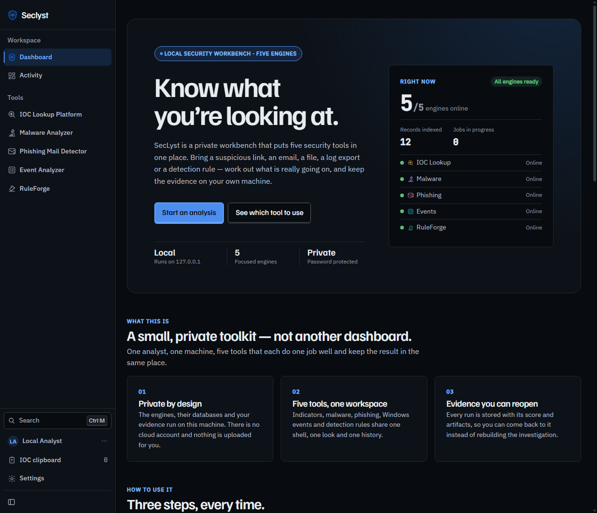
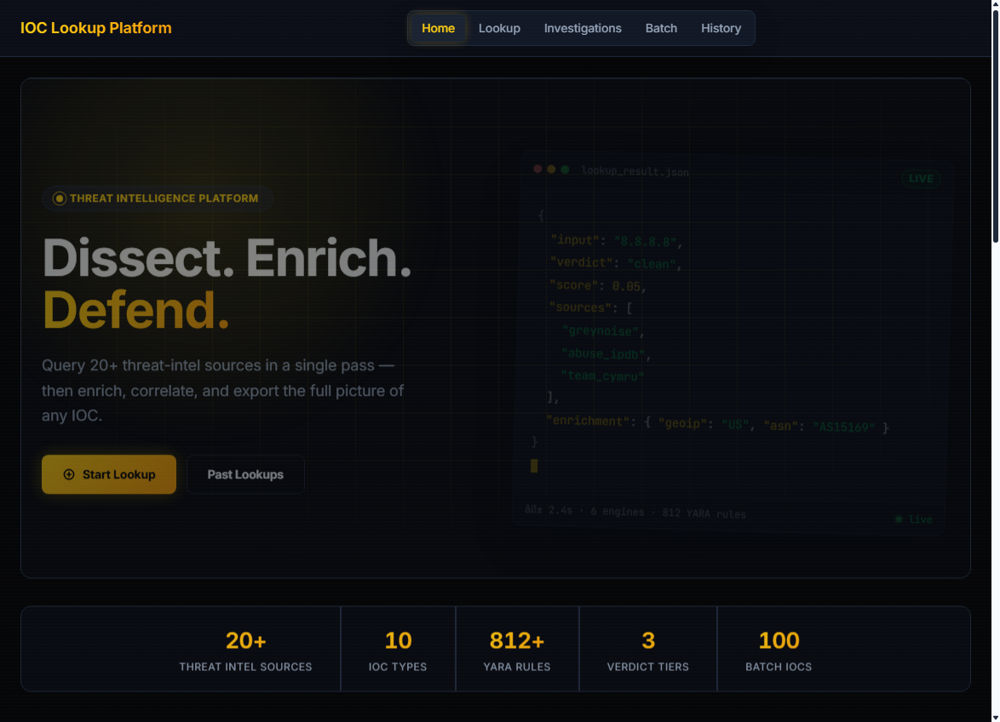
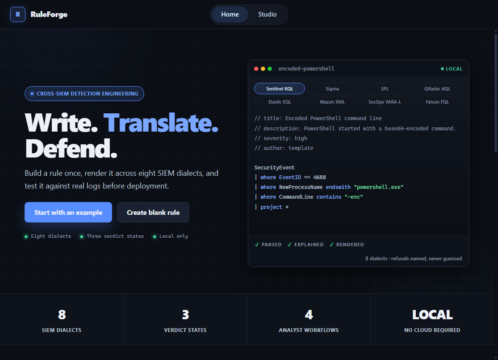
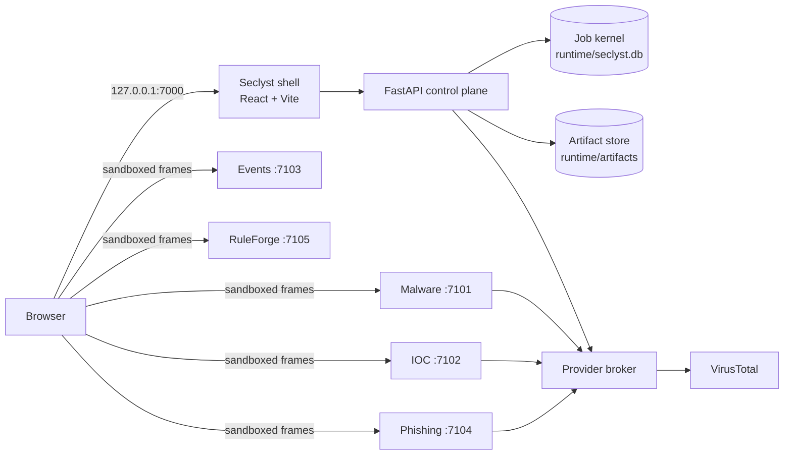

# Seclyst

**A unified local security analysis platform.** Seclyst runs five independent security tools behind one workbench, one launch command, and one shared control plane — without redrawing or rewriting any of the tools.

[](https://github.com/EclipseManic/SecLyst/actions/workflows/ci.yml)


---

## Overview

Security analysts usually keep five separate tools, five terminals, five config files, and five places to look for results. Seclyst turns that into one application.

Each tool keeps its original backend and its original interface. Seclyst runs every engine on its own loopback port, hosts the real interface edge-to-edge inside the workbench, and adds the layer that was missing: shared navigation, live health, aggregated recent work, a shared clipboard, durable jobs, and coordinated provider access.

The result is a single analyst console where a finding in one tool can move to the next tool without leaving the app or losing state.

## Screenshots



| IOC Lookup | Malware Analyzer | Phishing Detector |
| --- | --- | --- |
|  |  |  |

| Event Analyzer | RuleForge |
| --- | --- |
|  |  |

These are captures of a running instance, not mockups. [`docs/screenshots/`](docs/screenshots/) lists what each image shows and the command that regenerates them.

## The five tools

| Tool | Purpose | Port | Engine |
| --- | --- | ---: | --- |
| **IOC Lookup Platform** | Indicator enrichment, history, and export | 7102 | [`ioc`](docs/ENGINES.md#ioc-lookup) |
| **Malware Analyzer** | Static analysis, YARA matching, PE inspection, risk scoring | 7101 | [`malware`](docs/ENGINES.md#malware-analyzer) |
| **Event Analyzer** | EVTX ingestion, Sigma matching, MITRE ATT&CK mapping | 7103 | [`events`](docs/ENGINES.md#event-analyzer) |
| **Phishing Mail Detector** | Header, body, URL, and attachment analysis | 7104 | [`phishing`](docs/ENGINES.md#phishing-detector) |
| **RuleForge** | Detection rule authoring across eight SIEM dialects | 7105 | [`ruleforge`](docs/ENGINES.md#ruleforge) |

RuleForge dialects: Sigma, Splunk, Elastic, Sentinel KQL, QRadar, Chronicle, CrowdStrike, and Wazuh.

## Capabilities

- **One launch.** A single command starts the workbench and all five engines, and one shutdown stops everything.
- **Original interfaces preserved.** Tool UIs are served by their own backends, so REST calls, server-sent events, WebSockets, uploads, and downloads behave exactly as they did standalone.
- **Persistent tool state.** A tool mounts on first visit and stays mounted, so switching tools preserves route, form state, and live connections.
- **Durable job kernel.** Long-running analysis survives navigation and restarts through a SQLite WAL job queue with ordered events, leases, and recovery.
- **Coordinated provider access.** VirusTotal lookups from Malware, Phishing, and IOC share one broker with a global rate policy, single-flight deduplication, response caching, and a circuit breaker.
- **Content-addressed artifacts.** Uploads stream while hashing, one immutable object per SHA-256, with derivation edges and quarantine-safe downloads.
- **Loopback-only by default.** Every listener is bound to loopback and guarded by a per-launch access token.

## Architecture



The shell never proxies or rewrites tool traffic. Each interface talks to its own backend on its own origin, which keeps the tools independent and prevents CSS or script collisions. See [`docs/ARCHITECTURE.md`](docs/ARCHITECTURE.md) for the process model, browser boundary, and failure model.

## Requirements

- Python 3.11 or newer
- Node.js 20 or newer with npm
- A modern Chromium, Firefox, or Edge browser
- Optional native utilities used by individual analyzers: Tesseract OCR, `libmagic`, `libzbar`

## Installation

```bash
python scripts/setup.py
```

The setup script creates `.venv`, installs the Python engines, installs locked Node dependencies, and builds both the Seclyst shell and the IOC interface.

```bash
python scripts/setup.py --dev          # add the test and browser-verification toolchain
python scripts/setup.py --skip-python  # rebuild interfaces only
```

## Running

Windows:

```powershell
.venv\Scripts\python.exe run.py
```

Linux or macOS:

```bash
.venv/bin/python run.py
```

Seclyst opens at **http://127.0.0.1:7000/**.

| Flag | Effect |
| --- | --- |
| `--no-browser` | Start without opening a browser window |
| `--no-engines` | Serve the shell only, without starting engines |
| `--port <n>` | Change the shell port from `7000` |
| `--host <h>` | Choose a loopback host (`127.0.0.1`, `localhost`, `::1`) |

Engine ports are not standalone entry points while Seclyst is running. Each launch creates a random access token, the shell bootstraps HttpOnly engine sessions, supervisor probes authenticate with a private header, and direct unauthenticated requests to ports 7101–7105 are rejected.

## Configuration

Copy `.env.example` to `.env`. The file is loaded server-side and inherited by the engines; values are never exposed to the browser or written to local storage.

| Variable | Default | Purpose |
| --- | --- | --- |
| `SECLYST_MALWARE_PORT` … `SECLYST_RULEFORGE_PORT` | `7101`–`7105` | Internal engine ports |
| `SECLYST_DURABLE_JOBS` | `true` | Durable job kernel (rollback switch) |
| `SECLYST_PROVIDER_BROKER` | `true` | Shared provider broker (rollback switch) |
| `SECLYST_JOB_LEASE_SECONDS` | `30` | Worker lease duration |
| `SECLYST_DATABASE_PATH` | `runtime/seclyst.db` | Control-plane database |
| `SECLYST_ARTIFACT_MAX_BYTES` | `104857600` | Per-artifact upload limit |
| `VT_API_KEY`, `TRIAGE_API_KEY`, `URL_SCAN_API_KEY` | empty | Threat-intelligence credentials |
| `SHODAN_API_KEY`, `GREYNOISE_API_KEY`, `IPINFO_API_KEY`, `ETHERSCAN_API_KEY` | empty | Enrichment credentials |
| `ENABLE_ACTIVE_PORT_SCAN` | `false` | Active network scanning |
| `ENABLE_URL_CONTENT_FETCH` | `false` | Outbound URL fetching |
| `ENABLE_PUBLIC_URL_SUBMISSION` | `false` | Public sample submission |
| `WEBHOOKS_ENABLED` | `false` | Outbound webhooks |

Active and external actions are disabled by default. Adding a provider key does not opt a sample into public submission.

Credentials can also be stored in the operating-system keyring instead of `.env`:

```bash
.venv/bin/python -m seclyst credentials set virustotal
.venv/bin/python -m seclyst credentials status
```

Settings shows the detected key source and environment variable name for every provider.

## Runtime layout

| Service | Port | Interface |
| --- | ---: | --- |
| Seclyst shell | 7000 | Unified workbench |
| Malware Analyzer | 7101 | Original Malware Analyzer UI |
| IOC Lookup | 7102 | Original IOC React UI |
| Event Analyzer | 7103 | Original Event Analyzer UI |
| Phishing Detector | 7104 | Original Phishing UI |
| RuleForge | 7105 | Original RuleForge UI |

All mutable state is written under `runtime/`, which is excluded from version control:

```
runtime/
├── artifacts/     # content-addressed uploads
├── events/        # EVTX databases and uploads
├── ioc/           # IOC database and cache
├── malware/       # scan and cache databases
├── phishing/      # scan database
├── ruleforge/     # rule history
├── logs/          # per-engine logs
└── seclyst.db     # control-plane database
```

## API

The workbench and engines share one FastAPI control plane.

| Endpoint | Purpose |
| --- | --- |
| `GET /api/platform/status` | Measured engine health and configured tool URLs |
| `GET /api/platform/summary` | Recent work aggregated from engine history |
| `/api/v1/jobs` | Durable job creation, status, events, and actions |
| `/api/v1/artifacts` | Artifact metadata and downloads |
| `/api/v1/runs` | Run history |
| `/api/v1/intake` | Email-to-detection intake |
| `/api/v1/settings` | Provider and engine configuration |
| `/internal/v1` | Engine-to-platform channel (not in the public schema) |

## Security model

- All listeners bind to loopback only.
- Cross-origin tool frames are sandboxed, so tool scripts cannot read shell state.
- A per-launch token gates every engine port; direct unauthenticated access is rejected.
- Provider secrets stay server-side and are withheld from engines when the broker is active.
- Artifacts are never rendered inline; downloads use attachment disposition and enforce size limits.
- Active scanning, URL fetching, public submission, and webhooks are opt-in.

## Development

Run the platform suite:

```bash
.venv/bin/python -m pytest
.venv/bin/python -m ruff check .
```

Build and test the frontends:

```bash
npm --prefix apps/web run build
npm --prefix apps/web test
npm --prefix engines/ioc/ui test
npm --prefix engines/ioc/ui run build
```

Run the complete verification chain:

```bash
.venv/bin/python scripts/verify.py
```

On Windows, replace `.venv/bin/python` with `.venv\Scripts\python.exe`. The same chain runs in CI on every push and pull request (see [`.github/workflows/ci.yml`](.github/workflows/ci.yml)).

## Repository layout

```
Seclyst/
├── apps/web/            # Seclyst shell (React + Vite)
├── engines/             # The five analysis engines
│   ├── events/          # Event Analyzer
│   ├── ioc/             # IOC Lookup Platform
│   ├── malware/         # Malware Analyzer
│   ├── phishing/        # Phishing Mail Detector
│   └── ruleforge/       # RuleForge
├── seclyst/             # Control plane: API, jobs, providers, artifacts
├── migrations/          # Alembic migrations
├── tests/               # Platform test suite
├── scripts/             # Setup and verification tooling
├── docs/                # Architecture, operations, provenance
├── runtime/             # Local state (git-ignored)
└── run.py               # Entry point
```

## Troubleshooting

| Symptom | Cause and fix |
| --- | --- |
| A tool shows as offline | Check `runtime/logs/<tool>.log`; the other engines keep running |
| Engine port already in use | Seclyst reports the conflict instead of attaching to an unknown process; change the port in `.env` |
| Blank shell page | The shell was not built; run `python scripts/setup.py --skip-python` |
| Missing OCR or magic errors | Install the optional native utilities listed in Requirements |

See [`docs/OPERATIONS.md`](docs/OPERATIONS.md) for recovery and credential procedures.

## Documentation

- [Documentation index](docs/README.md) — every page, and the order to read them in
- [Architecture](docs/ARCHITECTURE.md) — process model, browser boundary, failure model
- [Engines](docs/ENGINES.md) — the five engines, their contracts, and their boundaries
- [Operations](docs/OPERATIONS.md) — runtime, recovery, credentials, storage
- [Sources](docs/SOURCES.md) — engine provenance and integrity notes
- [API](docs/API.md) — the platform HTTP surface
- [Screenshots](docs/screenshots/) — real captures and how to regenerate them
- [Internal notes](docs/internal/) — historical design records, not user documentation

## License

MIT. See [`LICENSE`](LICENSE). All five engines are original work by the repository owner.
