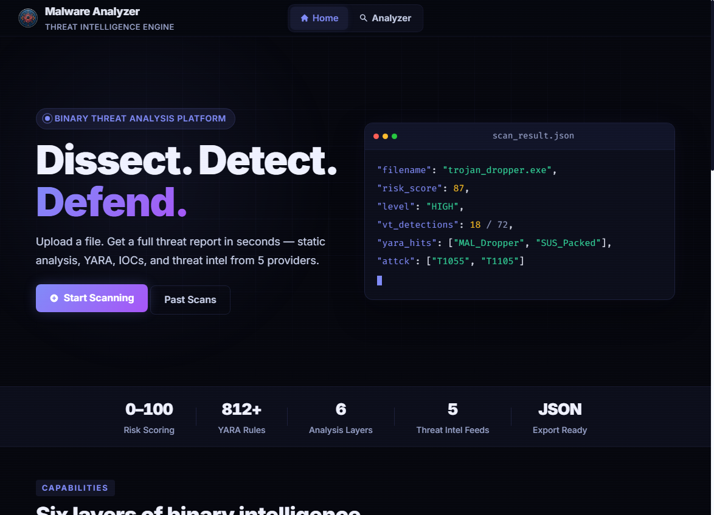
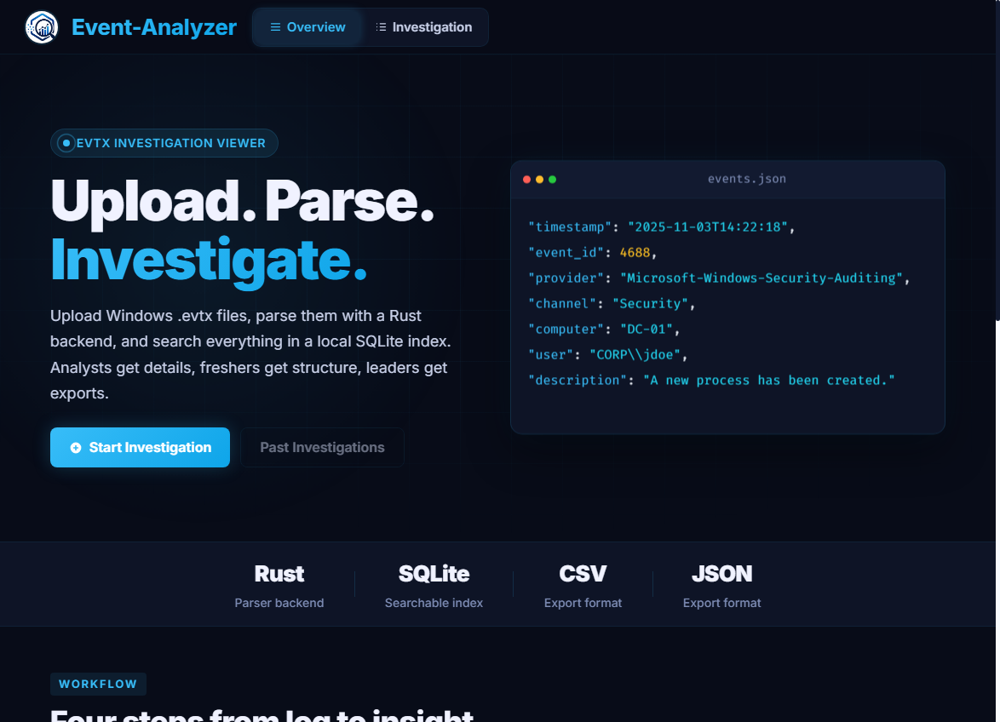
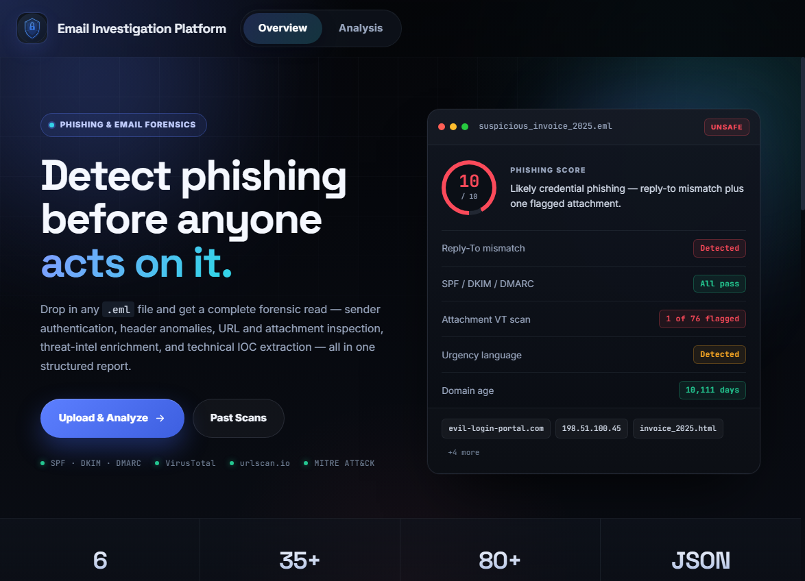

# Seclyst

**Five security analysis tools. One console.**

Seclyst is a local platform that brings five independent security tools together
behind a single workbench. It lets an analyst triage a suspicious file, enrich an
indicator, hunt through Windows event logs, dissect a phishing email, and turn
the result into a detection rule — without juggling five terminals, five browser
tabs, and five sets of results.

Each tool keeps **its own original backend and its own original interface**.
Seclyst runs them on separate ports, hosts the real interfaces inside one console,
and adds the layer that was always missing: shared navigation, live health,
aggregated recent work, job tracking, and one place for API keys.

[](https://github.com/EclipseManic/SecLyst/actions/workflows/ci.yml)


---

## Why this exists

A real investigation crosses tools constantly. You pull a hash out of an alert,
look it up, find a dropped file, scan the file, read the log that shows how it
ran, trace the email that delivered it, and finally write a rule so the next
analyst catches it automatically.

Every one of those steps usually means a different tool with its own login, its
own history, and its own copy of your notes. Seclyst removes that friction. It
does not re-implement the tools or dumb them down — it keeps them exactly as they
are and unifies the space around them, so the finding you just made in one tool
is still there when you switch to the next.

## The five tools

Each tool is the genuine article: the original backend and the original interface,
running on its own port and framed inside the console. What follows is what each
one does and why an analyst reaches for it.

### 1. IOC Lookup — *"Is this indicator known-bad?"*

Enrichment and investigation for indicators of compromise: IP addresses, domains,
file hashes, URLs, crypto wallets, phone numbers, and breached credentials.

- **What it does:** queries multiple threat-intelligence providers for a single
  indicator and returns a **consensus verdict**, with each provider's raw evidence
  kept next to the score so you can see exactly what produced it.
- **Why it matters:** one provider is often wrong or silent. Cross-checking several
  and keeping the evidence is the difference between a guess and a defensible call.
- **Also there:** a relationship graph between indicators, structured exports,
  batch enrichment, and saved investigations.


### 2. Malware Analyzer — *"What is this file, and what does it do?"*

Static, threat-intelligence, sandbox, and YARA analysis of a suspicious payload.

- **What it does:** inspects executable and document structure (PE, ELF, Mach-O,
  Office, PDF, archives), runs a bundled YARA corpus, and raises capability flags.
- **Why it matters:** it answers the first question in any incident — is this
  benign, unknown, or malicious — and gives you the indicators to keep hunting.
- **Optional cloud enrichment:** VirusTotal, Hybrid Analysis, Triage, and FileScan.
  Submitting an unknown sample to a public service is **off by default**.



### 3. Event Analyzer — *"What actually happened on this host?"*

Windows event-log (EVTX) ingestion, search, and threat hunting.

- **What it does:** ingests EVTX files into a local, searchable index, extracts
  indicators, and matches **Sigma rules**, tagging hits with MITRE ATT&CK
  techniques.
- **Why it matters:** the log is where an intrusion becomes visible. This turns
  thousands of raw events into the handful that matter, with the technique named.
- **Also there:** analyst notes, bookmarks, and report exports.



### 4. Phishing Mail Detector — *"Is this email a phish, and why?"*

Email authentication, routing, content, and attachment forensics.

- **What it does:** checks SPF, DKIM, DMARC, and ARC; analyses the sender and any
  lookalike domain; walks the mail hops; inspects URLs and body content for
  credential-harvesting patterns; and reads attachments with text extraction,
  QR decoding, and OCR.
- **Why it matters:** phishing is how most incidents start. This gives a verdict
  **and the reasons behind it**, so the call can be explained, not just asserted.
- **Also there:** risk scoring and MITRE ATT&CK mapping.



### 5. RuleForge — *"Turn what we learned into a detection."*

Cross-SIEM detection engineering with explicit, honest refusals.

- **What it does:** authors, translates, tunes, and tests detection logic across
  **Sigma, Splunk, Elastic, Sentinel KQL, QRadar, Chronicle, CrowdStrike, and
  Wazuh**, using a deterministic evaluation engine and a visual pipeline editor.
- **Why it matters:** the investigation closes the loop only when a rule exists so
  the same activity is caught automatically next time.
- **Its best feature is a refusal:** it will decline a translation it cannot make
  correctly rather than emit a rule that looks valid and silently is not. Its
  evaluator is three-valued, so an unknown field is never quietly treated as false.
- **Deliberately dependency-free:** RuleForge is standard-library only, so it runs
  inside a locked-down SOC where `pip install` is not available.


## What the console adds

The five tools are the point. This is what makes them one product instead of five
tabs:

- **One launch.** A single command starts the console and all five tools; one
  shutdown stops everything.
- **Original interfaces, untouched.** Tool UIs are served by their own backends,
  so REST calls, server-sent events, WebSockets, uploads, and downloads behave
  exactly as they did standalone.
- **Persistent tool state.** A tool mounts on first visit and stays mounted, so
  switching tools keeps your route, form state, and live connections.
- **Durable jobs.** Long-running analysis survives navigation and restarts through
  a SQLite job queue with ordered events, leases, and recovery.
- **One place for keys.** VirusTotal lookups from three different tools share one
  broker with a global rate policy, de-duplication, caching, and a circuit breaker.
- **Loopback-only by default.** Every listener is bound to your machine and guarded
  by a per-launch access token. Active scanning, URL fetching, public submission,
  and webhooks are all opt-in.

Want the full picture — architecture, the API, storage, security model, and how to
extend it? Read **[DETAILS.md](DETAILS.md)**.

## Screenshots

Every screen image lives in **[`gallery/`](gallery/)** — real captures of a running
instance, plus the original interface of each engine, screen by screen.

## Requirements

- Python **3.11+**
- Node.js **20+** with npm
- A modern Chromium, Firefox, or Edge browser
- Optional native utilities used by individual analyzers: Tesseract OCR,
  `libmagic`, `libzbar`

## Install

```bash
python scripts/setup.py
```

The setup script creates `.venv`, installs the Python engines, installs locked
Node dependencies, and builds both the console and the IOC interface.

```bash
python scripts/setup.py --dev          # add the test and browser-verification toolchain
python scripts/setup.py --skip-python  # rebuild the interfaces only
```

## Run

Windows:

```powershell
.venv\Scripts\python.exe run.py
```

Linux or macOS:

```bash
.venv/bin/python run.py
```

Seclyst opens at **http://127.0.0.1:7000/**.

| Flag | Effect |
| --- | --- |
| `--no-browser` | Start without opening a browser window |
| `--no-engines` | Serve the console only, without starting the tools |
| `--port <n>` | Change the console port from `7000` |
| `--host <h>` | Choose a loopback host (`127.0.0.1`, `localhost`, `::1`) |

Tool ports (7101–7105) are not standalone entry points while Seclyst is running.
Each launch mints a random access token, the console bootstraps private tool
sessions, and direct unauthenticated requests to those ports are rejected.

## Configure

Copy `.env.example` to `.env`. Values are read server-side and inherited by the
tools; they are never exposed to the browser.

| Variable | Default | Purpose |
| --- | --- | --- |
| `SECLYST_MALWARE_PORT` … `SECLYST_RULEFORGE_PORT` | `7101`–`7105` | Internal tool ports |
| `SECLYST_DURABLE_JOBS` | `true` | Durable job kernel (rollback switch) |
| `SECLYST_PROVIDER_BROKER` | `true` | Shared provider broker (rollback switch) |
| `SECLYST_DATABASE_PATH` | `data/seclyst.db` | Control-plane database |
| `VT_API_KEY`, `TRIAGE_API_KEY`, `URL_SCAN_API_KEY` | empty | Threat-intelligence keys |
| `SHODAN_API_KEY`, `GREYNOISE_API_KEY`, `IPINFO_API_KEY`, `ETHERSCAN_API_KEY` | empty | Enrichment keys |
| `ENABLE_ACTIVE_PORT_SCAN` | `false` | Active network scanning |
| `ENABLE_URL_CONTENT_FETCH` | `false` | Outbound URL fetching |
| `ENABLE_PUBLIC_URL_SUBMISSION` | `false` | Public sample submission |
| `WEBHOOKS_ENABLED` | `false` | Outbound webhooks |

Secrets can live in your OS keyring instead of `.env`:

```bash
.venv/bin/python -m seclyst_backend credentials set virustotal
.venv/bin/python -m seclyst_backend credentials status
```

The **Settings** screen shows which source each key came from. Full details are in
[DETAILS.md](DETAILS.md#configuration-and-credentials).

## Project layout

| Path | What lives there |
| --- | --- |
| `web/` | The console UI — one React + Vite app. |
| `seclyst_backend/` | The platform backend: HTTP API, durable jobs, provider broker, artifacts, database, and schema migrations. |
| `engines/` | The five tools. Code and tests only — no UI, no docs, no manifests. |
| `tests/` | Platform test suite. Each tool keeps its own suite inside its folder. |
| `scripts/` | Setup, verification, and screenshot tooling. |
| `gallery/` | Screenshots: the console, and each tool's original interface. |
| `data/` | Local state: databases, uploads, logs. Git-ignored. |
| `DETAILS.md` | The deep-dive reference for everything above. |

## Documentation

- **[DETAILS.md](DETAILS.md)** — the deep-dive: every tool in depth, the platform
  design, the HTTP API, configuration, storage, security, operations, and how to
  add an engine.
- **[gallery/](gallery/)** — screenshots of the console and the original tools.

## License

MIT. See [`LICENSE`](LICENSE). All five tools are original work by the repository
owner.
